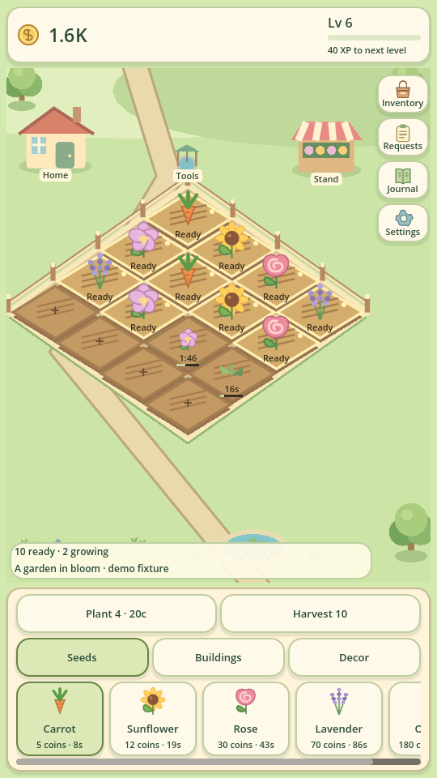
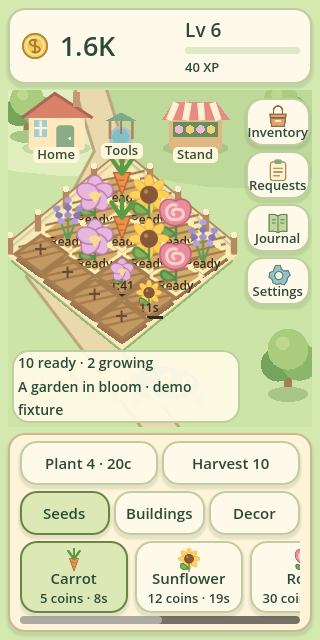

# Garden Empire

Version **0.5.0** · A playable, offline-first portrait gardening prototype built with **Godot 4.6.3 stable**. No external runtime dependencies, login, ads or purchases.



## Play
Open project.godot in Godot 4.6.3 and press **F5**, or run:
```sh
godot --path .
```

1. Choose Carrot, then tap a + plot. Seeds cost coins; starter carrots grow in 8 seconds.
2. Tap a ready plant to harvest; open Inventory to sell one or all.
3. Use **Plant** to fill as many empty plots as the displayed price allows, and **Harvest ready** to collect mature crops together.
4. Open **Requests** to grow deliveries for neighbours. Rewards include an explicit coin bonus and XP. Pin one request to reserve its ingredients from manual sales and the stand; unpin to release them.
5. Claim permanent goals in Journal, discover five species, earn XP and expand in Shop.
6. The flower stand sells your harvested inventory. A later helper harvests ready plants; neither creates free crops or replants.
7. Growth and stocked stand sales advance while away, capped at eight hours. Settings and progress save locally.

## Updating an existing game
Download the latest main-branch ZIP or pull main, then open its project.godot in Godot and press F5. Keep the application name Garden Empire: the new build reads the same local save folder. Saves from schemas 1–4 migrate to schema 5 automatically, preserving coins, inventory, planted crops, upgrades, goals and settings. No reset is needed.

## What's new in 0.5
- Fixed compact coin/XP HUD and an expanding illustrated garden; the game world is no longer inside a scrolling page.
- Independent clickable soil plots, visible plant artwork, cottage, stand and watering station. Tapping the cottage opens goals/collection; the stand opens upgrades or inventory; tools open upgrades.
- Side navigation for inventory, requests, journal and settings, with scrollable overlays and a fixed close button.
- Bottom seed/building/decor selector. All eight upgrades remain available; expensive purchases use an in-app confirmation with cancel/price validation.
- Three free garden looks saved locally. Original SVG plant art is shared between the world and selector.
- Bounded floating coin/XP/upgrade/plant feedback, static feedback for reduced motion, shorter layouts for short mobile viewports, and timed ordinary notices. Save warnings remain available.
- All previous gameplay is retained; no economy or progression tuning changed.



## Retained 0.4 features
- Three repeatable, non-expiring customer requests selected deterministically from eight recipes, with reservation-aware sales and unique delivery ids.
- One-tap batch planting/harvesting; planting never exceeds the displayed quantity, even if stand income arrives during the click.
- Per-plot timers and growth bars, an XP progress meter, next-species unlock hint, distinct procedural flowers, garden edging and fence.

Original procedural art and sounds. Keyboard focus and mouse input work through Godot controls; touch uses Godot mouse emulation. Android touch, haptics, physical safe areas and device performance remain unverified.

## Verification
From this repository:
```sh
tools/verify.sh
```
This imports scripts, runs **627 automated checks** (140 core + 104 requests + 383 redesign/migration/layout checks), then launches a headless runtime smoke test. It isolates test data in a temporary directory.

Additional checks:
```sh
# Requires a working display (~20s: two real growth cycles, sales and request delivery).
godot --path . --audio-driver Dummy --script tests/smoke_interaction.gd

# All 16 plots/artwork, buildings, upgrade confirmation/cancel, decor, restart.
# Omit --skip-benchmark to also rewrite docs/UI_RENDER_METRICS.json.
godot --path . --audio-driver Dummy --script tests/smoke_redesign.gd -- --skip-benchmark

# Four deterministic strategies, 10,000 synthetic players; ~3 minutes here.
# Rewrites docs/SIMULATION_RESULTS.json. For a quick run append: -- --runs=100
godot --headless --path . --script tests/simulation.gd

# 1,000 request-focused synthetic players; writes docs/REQUEST_SIMULATION_RESULTS.json.
godot --headless --path . --script tests/request_simulation.gd

# Actual engine screenshots, including the request board and 320px large text.
godot --path . --audio-driver Dummy --script tests/capture_preview.gd
```
Tests use their own save filenames. In a restricted environment with an unwritable home, prefix commands with:
```sh
XDG_DATA_HOME=/tmp/garden-data XDG_CONFIG_HOME=/tmp/garden-config XDG_CACHE_HOME=/tmp/garden-cache
```
For a headless Linux host with an existing virtual X server, also set DISPLAY appropriately (this session used :99 and Mesa llvmpipe). Preview fixtures are illustrative game states, not evidence of real player progress.

Developer coin control: `godot --path . -- --debug-garden` then Settings; only available in debug builds.

## Status and continuation
Redesign audit, architecture, milestones and limitations: [UI_REDESIGN.md](docs/UI_REDESIGN.md).
Desktop verification: 627 headless checks and 95 rendered pointer checks (25 original + 70 redesign). Actual screenshots show fresh state or explicitly seeded demo fixtures.

The virtual software renderer produced variable frame times and large spikes; see UI_RENDER_METRICS.json and UI_REDESIGN.md. No stable Android FPS, battery, physical dp/safe-area, or screen-reader acceptance is claimed.

M0–M2 are implemented and tested on desktop. M3 features are present; mobile accessibility and usability acceptance remain. M4 automated tests, simulation, Android preset and guide are present; **Android export fails here because SDK components and export templates are missing**. No APK or device performance is claimed. Economy is provisional: simulations expose fast progression and convergent optimal plant choices, requiring further tuning and human tests.

- [Implementation status](docs/IMPLEMENTATION_STATUS.md)
- [Testing evidence](docs/TEST_PLAN.md)
- [Baseline simulation results (0.3)](docs/SIMULATION_RESULTS.json)
- [Request simulation results (0.4)](docs/REQUEST_SIMULATION_RESULTS.json)
- [Economy and limitations](docs/ECONOMY.md)
- [Android setup and QA](docs/ANDROID.md)
- [Exact continuation steps](docs/CONTINUE.md)
- [Supplied master specification](docs/CODEX_MASTER_SPEC.md)
